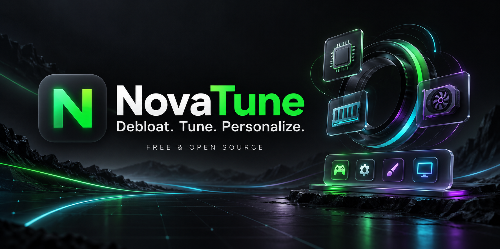
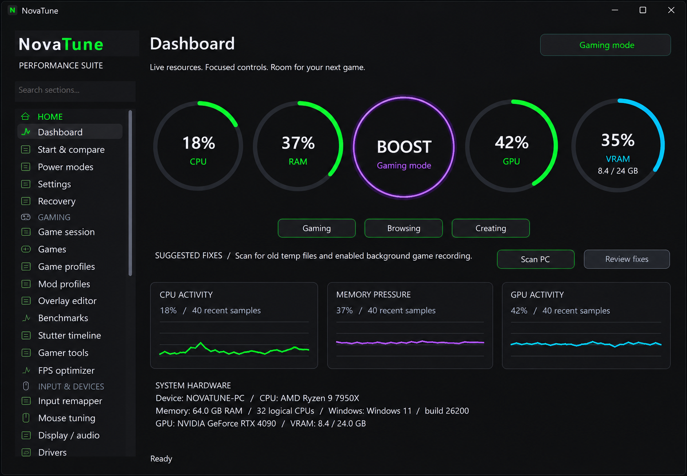

<div align="center">



### Less bloat. More play. Your style.

A **free & open-source** Windows toolkit that puts performance tools,
gaming controls, and desktop customization in one place.

**Native C++17 · Windows 10/11 x64 · Portable · Dark interface · MIT licensed**

[Get started](#-plug-in-your-next-upgrade) · [Explore the toolkit](#-one-app-more-control) · [Build it yourself](#-build-it-yourself)

</div>

---



## ⚡ One app. More control.

| Clear the clutter | Tune your setup | Make it yours |
| :--- | :--- | :--- |
| Remove selected unwanted Windows apps | One-click Boost with Gaming, Browsing, and Creating modes | Custom taskbar and dock with hover animations and auto-hide |
| Manage startup and background activity | Game profiles, process priorities, and a customizable HUD | Styled launcher and window switcher |
| Clean temporary files and find large or duplicate files | FPS capture, benchmarks, and a stutter timeline | Widgets, animated wallpapers, themes, and custom colors |
| Analyze disks and run Windows repair tools | Live CPU, RAM, GPU, and VRAM monitoring | Screen-corner actions and window snapping |

### 🎮 Beyond the boost button

- **Your controls, your rules.** Remap keyboard, mouse, Xbox, and PlayStation inputs across Windows. Tune pointer speed and acceleration.
- **Keep the moment.** Take screenshots, record your screen, save instant replays, and browse your captures.
- **Check the connection.** Test internet speed and inspect network diagnostics.
- **Keep a way back.** Review suggested fixes and restore supported changes through Recovery.

> **Real tools. Real measurements.** FPS gains vary by PC and game. Some features need supported hardware or optional tools such as PresentMon and WinGet. Recovery covers supported changes; deleted files are not recoverable through it.

## 📦 Plug in your next upgrade

**No installer. Just extract and run.**

1. Open the repository’s **Releases** page.
2. Download and extract **`NovaTune-Portable.zip`**.
3. Launch **`NovaTune.exe`**.

Administrator access is required. Closing the window keeps NovaTune in the tray; use **Quit** to exit. To update, quit and replace the executable. Settings stay in `%APPDATA%\NovaTune`.

## 🛠 Build it yourself

Bring **C++17**, **CMake 3.20+**, **Visual Studio C++ tools**, and a **Windows SDK**.

```powershell
cmake -S . -B build -A x64
cmake --build build --config Release --parallel
```

Your build lands at **`build/Release/NovaTune.exe`**.

Run tests manually in a Windows VM:

```powershell
ctest --test-dir build -C Release --output-on-failure
```

## 💚 Make NovaTune better

Found a bug? Have a useful idea? **Issues and pull requests are welcome.**

For bug reports, include your Windows version, relevant hardware, and steps to reproduce. Remove personal information from logs before sharing them.

---

<div align="center">

**Your PC has more to give.**

[MIT License](LICENSE) · Vendored NVIDIA headers retain their [upstream license](vendor/nvapi/License.txt).

</div>
